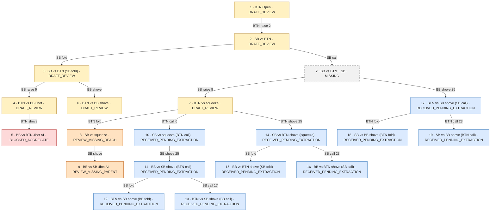

# Painel preflop — DeepGT

Gerado a partir de [PREFLOP_REGISTRY.json](../charts/PREFLOP_REGISTRY.json). Não editar manualmente; atualizar o registro e regenerar este painel.

🔵 Print recebido, extração pendente · 🟡 Codificado em revisão · 🟠 Revisão de reach/pai · 🔴 Bloqueado · ⚪ Pendente · 🟢 Validado/ativo (estado distinto no registro) · — Não aplicável confirmado.

## 1. Matriz de cobertura

| Cenário | 25 | 23 | 20 | 17 | 15 | 12 | 10 | 8 | 6 | 4 | 2 |
|---|---:|---:|---:|---:|---:|---:|---:|---:|---:|---:|---:|
| BTN Open | 🟡 | ⚪ | ⚪ | ⚪ | ⚪ | ⚪ | ⚪ | ⚪ | ⚪ | ⚪ | ⚪ |
| SB vs BTN | 🟡 | ⚪ | ⚪ | ⚪ | ⚪ | ⚪ | ⚪ | ⚪ | ⚪ | ⚪ | ⚪ |
| BB vs BTN (SB fold) | 🟡 | ⚪ | ⚪ | ⚪ | ⚪ | ⚪ | ⚪ | ⚪ | ⚪ | ⚪ | ⚪ |
| BTN vs BB 3bet | 🟡 | ⚪ | ⚪ | ⚪ | ⚪ | ⚪ | ⚪ | ⚪ | ⚪ | ⚪ | ⚪ |
| BB vs BTN 4bet AI | 🔴 | ⚪ | ⚪ | ⚪ | ⚪ | ⚪ | ⚪ | ⚪ | ⚪ | ⚪ | ⚪ |
| BTN vs BB shove | 🟡 | ⚪ | ⚪ | ⚪ | ⚪ | ⚪ | ⚪ | ⚪ | ⚪ | ⚪ | ⚪ |
| BTN vs squeeze | 🟡 | ⚪ | ⚪ | ⚪ | ⚪ | ⚪ | ⚪ | ⚪ | ⚪ | ⚪ | ⚪ |
| SB vs squeeze | 🟠 | ⚪ | ⚪ | ⚪ | ⚪ | ⚪ | ⚪ | ⚪ | ⚪ | ⚪ | ⚪ |
| BB vs SB 4bet AI | 🟠 | ⚪ | ⚪ | ⚪ | ⚪ | ⚪ | ⚪ | ⚪ | ⚪ | ⚪ | ⚪ |
| BB vs BTN + SB | ⚪ | ⚪ | ⚪ | ⚪ | ⚪ | ⚪ | ⚪ | ⚪ | ⚪ | ⚪ | ⚪ |
| SB vs squeeze (BTN call) | 🔵 | ⚪ | ⚪ | ⚪ | ⚪ | ⚪ | ⚪ | ⚪ | ⚪ | ⚪ | ⚪ |
| BB vs SB shove (BTN call) | 🔵 | ⚪ | ⚪ | ⚪ | ⚪ | ⚪ | ⚪ | ⚪ | ⚪ | ⚪ | ⚪ |
| BTN vs SB shove (BB fold) | 🔵 | ⚪ | ⚪ | ⚪ | ⚪ | ⚪ | ⚪ | ⚪ | ⚪ | ⚪ | ⚪ |
| BTN vs SB shove (BB call) | 🔵 | ⚪ | ⚪ | ⚪ | ⚪ | ⚪ | ⚪ | ⚪ | ⚪ | ⚪ | ⚪ |
| SB vs BTN shove (squeeze) | 🔵 | ⚪ | ⚪ | ⚪ | ⚪ | ⚪ | ⚪ | ⚪ | ⚪ | ⚪ | ⚪ |
| BB vs BTN shove (SB fold) | 🔵 | ⚪ | ⚪ | ⚪ | ⚪ | ⚪ | ⚪ | ⚪ | ⚪ | ⚪ | ⚪ |
| BB vs BTN shove (SB call) | 🔵 | ⚪ | ⚪ | ⚪ | ⚪ | ⚪ | ⚪ | ⚪ | ⚪ | ⚪ | ⚪ |
| BTN vs BB shove (SB call) | 🔵 | ⚪ | ⚪ | ⚪ | ⚪ | ⚪ | ⚪ | ⚪ | ⚪ | ⚪ | ⚪ |
| SB vs BB shove (BTN fold) | 🔵 | ⚪ | ⚪ | ⚪ | ⚪ | ⚪ | ⚪ | ⚪ | ⚪ | ⚪ | ⚪ |
| SB vs BB shove (BTN call) | 🔵 | ⚪ | ⚪ | ⚪ | ⚪ | ⚪ | ⚪ | ⚪ | ⚪ | ⚪ | ⚪ |

A matriz abrange apenas famílias já identificadas; não mede a cobertura de toda a árvore GTO. Slots pendentes não implicam que o cenário seja legal em todos os stacks.

| Stack | Recebidos/identificados | A extrair | Revisão normal | Revisão especial | Bloqueados | Validados/ativos | Pendentes |
|---:|---:|---:|---:|---:|---:|---:|---:|
| 25 | 19/20 | 10 | 6 | 2 | 1 | 0 | 1 |
| 23 | 0/20 | 0 | 0 | 0 | 0 | 0 | 20 |
| 20 | 0/20 | 0 | 0 | 0 | 0 | 0 | 20 |
| 17 | 0/20 | 0 | 0 | 0 | 0 | 0 | 20 |
| 15 | 0/20 | 0 | 0 | 0 | 0 | 0 | 20 |
| 12 | 0/20 | 0 | 0 | 0 | 0 | 0 | 20 |
| 10 | 0/20 | 0 | 0 | 0 | 0 | 0 | 20 |
| 8 | 0/20 | 0 | 0 | 0 | 0 | 0 | 20 |
| 6 | 0/20 | 0 | 0 | 0 | 0 | 0 | 20 |
| 4 | 0/20 | 0 | 0 | 0 | 0 | 0 | 20 |
| 2 | 0/20 | 0 | 0 | 0 | 0 | 0 | 20 |

## 2. Sequências e árvores por stack

Históricos marcados como reconstruídos não foram integralmente exibidos no print. A sequência deve ser conferida com o pai e os blocos inferiores, antes de codificar. Os demais ramos ainda não identificados não são inferidos.

### 25 BB

| Print | Sequência anterior | Hero | Trecho visível / conferência | Estado |
|---:|---|---|---|---|
| 1 | Pote não aberto | BTN | — | 🟡 DRAFT_REVIEW |
| 2 | BTN raise 2 | SB | — | 🟡 DRAFT_REVIEW |
| 3 | BTN raise 2 → SB fold | BB | — | 🟡 DRAFT_REVIEW |
| 4 | BTN raise 2 → SB fold → BB raise 6 | BTN | — | 🟡 DRAFT_REVIEW |
| 5 | BTN raise 2 → SB fold → BB raise 6 → BTN shove | BB | — | 🔴 BLOCKED_AGGREGATE |
| 6 | BTN raise 2 → SB fold → BB shove | BTN | — | 🟡 DRAFT_REVIEW |
| 7 | BTN raise 2 → SB call → BB raise 8 | BTN | — | 🟡 DRAFT_REVIEW |
| 8 | BTN raise 2 → SB call → BB raise 8 → BTN fold | SB | — | 🟠 REVIEW_MISSING_REACH |
| 9 | BTN raise 2 → SB call → BB raise 8 → BTN fold → SB shove | BB | — | 🟠 REVIEW_MISSING_PARENT |
| — | BTN raise 2 → SB call | BB | — | ⚪ MISSING |
| 10 | BTN raise 2 → SB call → BB raise 8 → BTN call 6 | SB | BB raise 8 → BTN call 6 · PREFIX_RECONSTRUCTED_PENDING_REVIEW | 🔵 RECEIVED_PENDING_EXTRACTION |
| 11 | BTN raise 2 → SB call → BB raise 8 → BTN call 6 → SB shove 25 | BB | SB shove 25 · PREFIX_RECONSTRUCTED_PENDING_REVIEW | 🔵 RECEIVED_PENDING_EXTRACTION |
| 12 | BTN raise 2 → SB call → BB raise 8 → BTN call 6 → SB shove 25 → BB fold | BTN | SB shove 25 → BB fold · PREFIX_RECONSTRUCTED_PENDING_REVIEW | 🔵 RECEIVED_PENDING_EXTRACTION |
| 13 | BTN raise 2 → SB call → BB raise 8 → BTN call 6 → SB shove 25 → BB call 17 | BTN | SB shove 25 → BB call 17 · PREFIX_RECONSTRUCTED_PENDING_REVIEW | 🔵 RECEIVED_PENDING_EXTRACTION |
| 14 | BTN raise 2 → SB call → BB raise 8 → BTN shove 25 | SB | BTN shove 25 · PREFIX_RECONSTRUCTED_PENDING_REVIEW | 🔵 RECEIVED_PENDING_EXTRACTION |
| 15 | BTN raise 2 → SB call → BB raise 8 → BTN shove 25 → SB fold | BB | BTN shove 25 → SB fold · PREFIX_RECONSTRUCTED_PENDING_REVIEW | 🔵 RECEIVED_PENDING_EXTRACTION |
| 16 | BTN raise 2 → SB call → BB raise 8 → BTN shove 25 → SB call 23 | BB | BTN shove 25 → SB call 23 · PREFIX_RECONSTRUCTED_PENDING_REVIEW | 🔵 RECEIVED_PENDING_EXTRACTION |
| 17 | BTN raise 2 → SB call → BB shove 25 | BTN | BB shove 25 · PREFIX_RECONSTRUCTED_PENDING_REVIEW | 🔵 RECEIVED_PENDING_EXTRACTION |
| 18 | BTN raise 2 → SB call → BB shove 25 → BTN fold | SB | BB shove 25 → BTN fold · TAIL_CONFIRMED_BY_USER_PREFIX_RECONSTRUCTED | 🔵 RECEIVED_PENDING_EXTRACTION |
| 19 | BTN raise 2 → SB call → BB shove 25 → BTN call 23 | SB | BB shove 25 → BTN call 23 · TAIL_CONFIRMED_BY_USER_PREFIX_RECONSTRUCTED | 🔵 RECEIVED_PENDING_EXTRACTION |

## 3. Referências

- [Catálogo de charts](CHARTS_CATALOG.md): frequências, desvios e fontes.
- [Status atual](STATUS.md): gates e pendências.
- [Política de ingestão](PREFLOP_POLICY.md): regras de atualização.

Nenhum estado de revisão equivale a homologação. Consulte o status para confirmar ativação e testes nativos.
