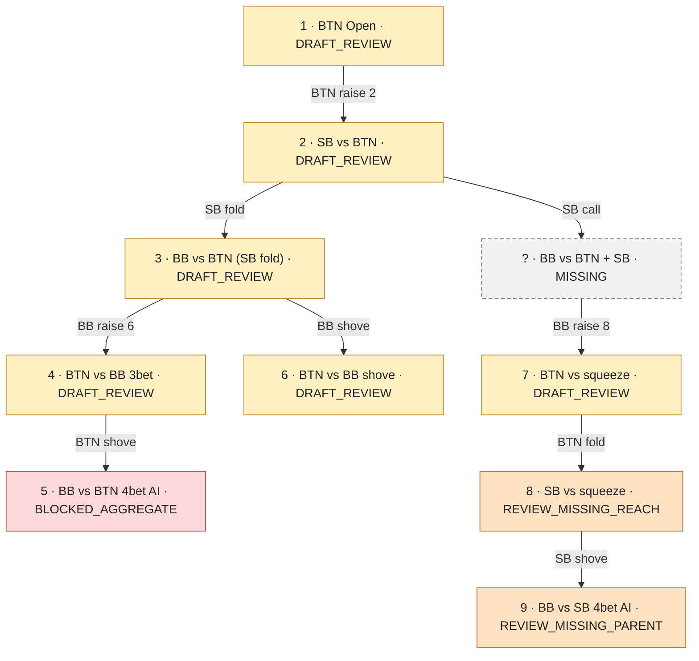

# Painel preflop — DeepGT

Gerado a partir de [PREFLOP_REGISTRY.json](../charts/PREFLOP_REGISTRY.json). Não editar manualmente; atualizar o registro e regenerar este painel.

🟡 Codificado em revisão · 🟠 Revisão de reach/pai · 🔴 Bloqueado · ⚪ Pendente · 🟢 Validado/ativo (estado distinto no registro) · — Não aplicável confirmado.

## 1. Matriz de cobertura

| Cenário | 25 | 23 | 20 | 17 | 15 | 12 | 10 | 8 | 6 | 4 | 2 |
|---|---:|---:|---:|---:|---:|---:|---:|---:|---:|---:|---:|
| BTN Open | 🟡 | ⚪ | ⚪ | ⚪ | ⚪ | ⚪ | ⚪ | ⚪ | ⚪ | ⚪ | ⚪ |
| SB vs BTN | 🟡 | ⚪ | ⚪ | ⚪ | ⚪ | ⚪ | ⚪ | ⚪ | ⚪ | ⚪ | ⚪ |
| BB vs BTN (SB fold) | 🟡 | ⚪ | ⚪ | ⚪ | ⚪ | ⚪ | ⚪ | ⚪ | ⚪ | ⚪ | ⚪ |
| BTN vs BB 3bet | 🟡 | ⚪ | ⚪ | ⚪ | ⚪ | ⚪ | ⚪ | ⚪ | ⚪ | ⚪ | ⚪ |
| BB vs BTN 4bet AI | 🔴 | ⚪ | ⚪ | ⚪ | ⚪ | ⚪ | ⚪ | ⚪ | ⚪ | ⚪ | ⚪ |
| BTN vs BB shove | 🟡 | ⚪ | ⚪ | ⚪ | ⚪ | ⚪ | ⚪ | ⚪ | ⚪ | ⚪ | ⚪ |
| BTN vs squeeze | 🟡 | ⚪ | ⚪ | ⚪ | ⚪ | ⚪ | ⚪ | ⚪ | ⚪ | ⚪ | ⚪ |
| SB vs squeeze | 🟠 | ⚪ | ⚪ | ⚪ | ⚪ | ⚪ | ⚪ | ⚪ | ⚪ | ⚪ | ⚪ |
| BB vs SB 4bet AI | 🟠 | ⚪ | ⚪ | ⚪ | ⚪ | ⚪ | ⚪ | ⚪ | ⚪ | ⚪ | ⚪ |
| BB vs BTN + SB | ⚪ | ⚪ | ⚪ | ⚪ | ⚪ | ⚪ | ⚪ | ⚪ | ⚪ | ⚪ | ⚪ |

A matriz abrange apenas famílias já identificadas; não mede a cobertura de toda a árvore GTO. Slots pendentes não implicam que o cenário seja legal em todos os stacks.

| Stack | Recebidos/identificados | Revisão normal | Revisão especial | Bloqueados | Validados/ativos | Pendentes |
|---:|---:|---:|---:|---:|---:|---:|
| 25 | 9/10 | 6 | 2 | 1 | 0 | 1 |
| 23 | 0/10 | 0 | 0 | 0 | 0 | 10 |
| 20 | 0/10 | 0 | 0 | 0 | 0 | 10 |
| 17 | 0/10 | 0 | 0 | 0 | 0 | 10 |
| 15 | 0/10 | 0 | 0 | 0 | 0 | 10 |
| 12 | 0/10 | 0 | 0 | 0 | 0 | 10 |
| 10 | 0/10 | 0 | 0 | 0 | 0 | 10 |
| 8 | 0/10 | 0 | 0 | 0 | 0 | 10 |
| 6 | 0/10 | 0 | 0 | 0 | 0 | 10 |
| 4 | 0/10 | 0 | 0 | 0 | 0 | 10 |
| 2 | 0/10 | 0 | 0 | 0 | 0 | 10 |

## 2. Sequências e árvores por stack

Apenas históricos explicitamente registrados são desenhados. Uma chart faltante conhecida pode aparecer como nó pendente. Os demais ramos ainda não identificados não são inferidos.

### 25 BB

| Print | Sequência anterior | Hero | Estado |
|---:|---|---|---|
| 1 | Pote não aberto | BTN | 🟡 DRAFT_REVIEW |
| 2 | BTN raise 2 | SB | 🟡 DRAFT_REVIEW |
| 3 | BTN raise 2 → SB fold | BB | 🟡 DRAFT_REVIEW |
| 4 | BTN raise 2 → SB fold → BB raise 6 | BTN | 🟡 DRAFT_REVIEW |
| 5 | BTN raise 2 → SB fold → BB raise 6 → BTN shove | BB | 🔴 BLOCKED_AGGREGATE |
| 6 | BTN raise 2 → SB fold → BB shove | BTN | 🟡 DRAFT_REVIEW |
| 7 | BTN raise 2 → SB call → BB raise 8 | BTN | 🟡 DRAFT_REVIEW |
| 8 | BTN raise 2 → SB call → BB raise 8 → BTN fold | SB | 🟠 REVIEW_MISSING_REACH |
| 9 | BTN raise 2 → SB call → BB raise 8 → BTN fold → SB shove | BB | 🟠 REVIEW_MISSING_PARENT |
| — | BTN raise 2 → SB call | BB | ⚪ MISSING |

## 3. Referências

- [Catálogo de charts](CHARTS_CATALOG.md): frequências, desvios e fontes.
- [Status atual](STATUS.md): gates e pendências.
- [Política de ingestão](PREFLOP_POLICY.md): regras de atualização.

Nenhum estado de revisão equivale a homologação. Consulte o status para confirmar ativação e testes nativos.
