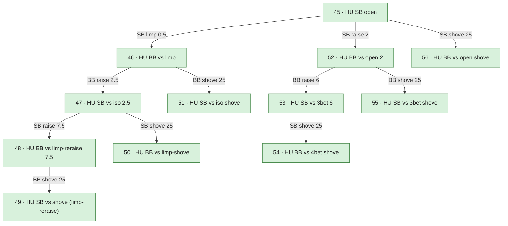
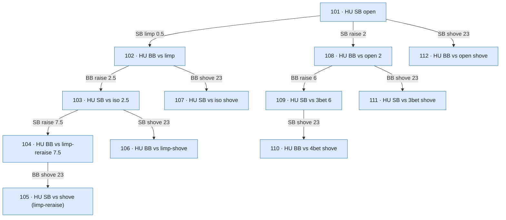

# Painel preflop — DeepGT

## 1. Lista contínua dos prints

Numeração global, permanente, por ordem de recebimento (todos os stacks). Não intercalar cenários ainda sem print, nem renumerar ao preencher lacunas da árvore.

**Último print registrado: 112. Próximo print novo: 113.**

| Print | Stack (BB) | Origem | Sequência anterior | Hero | Estado |
|---:|---:|---|---|:---:|---|
| 1 | 25 | 3-handed | Pote não aberto | BTN | 🟢 Codificada |
| 2 | 25 | 3-handed | BTN raise 2 | SB | 🟢 Codificada |
| 3 | 25 | 3-handed | BTN raise 2 → SB fold | BB | 🟢 Codificada |
| 4 | 25 | 3-handed | BTN raise 2 → SB fold → BB raise 6 | BTN | 🟢 Codificada |
| 5 | 25 | 3-handed | BTN raise 2 → SB fold → BB raise 6 → BTN shove | BB | 🟢 Codificada |
| 6 | 25 | 3-handed | BTN raise 2 → SB fold → BB shove | BTN | 🟢 Codificada |
| 7 | 25 | 3-handed | BTN raise 2 → SB call → BB raise 8 | BTN | 🟢 Codificada |
| 8 | 25 | 3-handed | BTN raise 2 → SB call → BB raise 8 → BTN fold | SB | 🟢 Codificada |
| 9 | 25 | 3-handed | BTN raise 2 → SB call → BB raise 8 → BTN fold → SB shove | BB | 🟢 Codificada |
| 10 | 25 | 3-handed | BTN raise 2 → SB call → BB raise 8 → BTN call 6 | SB | 🟢 Codificada |
| 11 | 25 | 3-handed | BTN raise 2 → SB call → BB raise 8 → BTN call 6 → SB shove 25 | BB | 🟢 Codificada |
| 12 | 25 | 3-handed | BTN raise 2 → SB call → BB raise 8 → BTN call 6 → SB shove 25 → BB fold | BTN | 🟢 Codificada |
| 13 | 25 | 3-handed | BTN raise 2 → SB call → BB raise 8 → BTN call 6 → SB shove 25 → BB call 17 | BTN | 🟢 Codificada |
| 14 | 25 | 3-handed | BTN raise 2 → SB call → BB raise 8 → BTN shove 25 | SB | 🟢 Codificada |
| 15 | 25 | 3-handed | BTN raise 2 → SB call → BB raise 8 → BTN shove 25 → SB fold | BB | 🟢 Codificada |
| 16 | 25 | 3-handed | BTN raise 2 → SB call → BB raise 8 → BTN shove 25 → SB call 23 | BB | 🟢 Codificada |
| 17 | 25 | 3-handed | BTN raise 2 → SB call → BB shove 25 | BTN | 🟢 Codificada |
| 18 | 25 | 3-handed | BTN raise 2 → SB call → BB shove 25 → BTN fold | SB | 🟢 Codificada |
| 19 | 25 | 3-handed | BTN raise 2 → SB call → BB shove 25 → BTN call 23 | SB | 🟢 Codificada |
| 20 | 25 | 3-handed | BTN raise 2 → SB raise 6 | BB | 🟢 Codificada |
| 21 | 25 | 3-handed | BTN raise 2 → SB raise 6 → BB fold | BTN | 🟢 Codificada |
| 22 | 25 | 3-handed | BTN raise 2 → SB raise 6 → BB fold → BTN shove 25 | SB | 🟢 Codificada |
| 23 | 25 | 3-handed | BTN raise 2 → SB raise 6 → BB shove 25 | BTN | 🟢 Codificada |
| 24 | 25 | 3-handed | BTN raise 2 → SB raise 6 → BB shove 25 → BTN fold | SB | 🟢 Codificada |
| 25 | 25 | 3-handed | BTN raise 2 → SB raise 6 → BB shove 25 → BTN call 23 | SB | 🟢 Codificada |
| 26 | 25 | 3-handed | BTN raise 2 → SB shove 25 | BB | 🟢 Codificada |
| 27 | 25 | 3-handed | BTN raise 2 → SB shove 25 → BB fold | BTN | 🟢 Codificada |
| 28 | 25 | 3-handed | BTN raise 2 → SB shove 25 → BB call 24 | BTN | 🟢 Codificada |
| 29 | 25 | 3-handed | BTN shove 25 | SB | 🟢 Codificada |
| 30 | 25 | 3-handed | BTN shove 25 → SB fold | BB | 🟢 Codificada |
| 31 | 25 | 3-handed | BTN shove 25 → SB call 24.5 | BB | 🟢 Codificada |
| 32 | 25 | 3-handed | BTN fold → SB limp 0.5 | BB | 🟢 Codificada |
| 33 | 25 | 3-handed | BTN fold → SB limp 0.5 → BB raise 3 | SB | 🟢 Codificada |
| 34 | 25 | 3-handed | BTN fold → SB limp 0.5 → BB raise 3 → SB raise 9 | BB | 🟢 Codificada |
| 35 | 25 | 3-handed | BTN fold → SB limp 0.5 → BB raise 3 → SB raise 9 → BB shove 25 | SB | 🟢 Codificada |
| 36 | 25 | 3-handed | BTN fold → SB limp 0.5 → BB raise 3 → SB shove 25 | BB | 🟢 Codificada |
| 37 | 25 | 3-handed | BTN fold → SB limp 0.5 → BB shove 25 | SB | 🟢 Codificada |
| 38 | 25 | 3-handed | BTN fold → SB raise 3 | BB | 🟢 Codificada |
| 39 | 25 | 3-handed | BTN fold → SB raise 3 → BB raise 9 | SB | 🟢 Codificada |
| 40 | 25 | 3-handed | BTN fold → SB raise 3 → BB raise 9 → SB shove 25 | BB | 🟢 Codificada |
| 41 | 25 | 3-handed | BTN fold → SB raise 3 → BB shove 25 | SB | 🟢 Codificada |
| 42 | 25 | 3-handed | BTN fold → SB shove 25 | BB | 🟢 Codificada |
| 43 | 25 | 3-handed | BTN raise 2 → SB call | BB | 🟢 Codificada |
| 44 | 25 | 3-handed | BTN fold | SB | 🟢 Codificada |
| 45 | 25 | HU nativo | Pote não aberto | SB | 🟢 Codificada |
| 46 | 25 | HU nativo | SB limp 0.5 | BB | 🟢 Codificada |
| 47 | 25 | HU nativo | SB limp 0.5 → BB raise 2.5 | SB | 🟢 Codificada |
| 48 | 25 | HU nativo | SB limp 0.5 → BB raise 2.5 → SB raise 7.5 | BB | 🟢 Codificada |
| 49 | 25 | HU nativo | SB limp 0.5 → BB raise 2.5 → SB raise 7.5 → BB shove 25 | SB | 🟢 Codificada |
| 50 | 25 | HU nativo | SB limp 0.5 → BB raise 2.5 → SB shove 25 | BB | 🟢 Codificada |
| 51 | 25 | HU nativo | SB limp 0.5 → BB shove 25 | SB | 🟢 Codificada |
| 52 | 25 | HU nativo | SB raise 2 | BB | 🟢 Codificada |
| 53 | 25 | HU nativo | SB raise 2 → BB raise 6 | SB | 🟢 Codificada |
| 54 | 25 | HU nativo | SB raise 2 → BB raise 6 → SB shove 25 | BB | 🟢 Codificada |
| 55 | 25 | HU nativo | SB raise 2 → BB shove 25 | SB | 🟢 Codificada |
| 56 | 25 | HU nativo | SB shove 25 | BB | 🟢 Codificada |
| 57 | 23 | 3-handed | Pote não aberto | BTN | 🔵 Recebida, falta codificar |
| 58 | 23 | 3-handed | BTN raise 2 | SB | 🔵 Recebida, falta codificar |
| 59 | 23 | 3-handed | BTN raise 2 → SB fold | BB | 🔵 Recebida, falta codificar |
| 60 | 23 | 3-handed | BTN raise 2 → SB fold → BB raise 6 | BTN | 🔵 Recebida, falta codificar |
| 61 | 23 | 3-handed | BTN raise 2 → SB fold → BB raise 6 → BTN shove 23 | BB | 🔵 Recebida, falta codificar |
| 62 | 23 | 3-handed | BTN raise 2 → SB fold → BB shove 23 | BTN | 🔵 Recebida, falta codificar |
| 63 | 23 | 3-handed | BTN raise 2 → SB call 1.5 | BB | 🔵 Recebida, falta codificar |
| 64 | 23 | 3-handed | BTN raise 2 → SB call 1.5 → BB raise 8 | BTN | 🔵 Recebida, falta codificar |
| 65 | 23 | 3-handed | BTN raise 2 → SB call 1.5 → BB raise 8 → BTN fold | SB | 🔵 Recebida, falta codificar |
| 66 | 23 | 3-handed | BTN raise 2 → SB call 1.5 → BB raise 8 → BTN fold → SB shove 23 | BB | 🔵 Recebida, falta codificar |
| 67 | 23 | 3-handed | BTN raise 2 → SB call 1.5 → BB raise 8 → BTN call 6 | SB | 🔵 Recebida, falta codificar |
| 68 | 23 | 3-handed | BTN raise 2 → SB call 1.5 → BB raise 8 → BTN call 6 → SB shove 23 | BB | 🔵 Recebida, falta codificar |
| 69 | 23 | 3-handed | BTN raise 2 → SB call 1.5 → BB raise 8 → BTN call 6 → SB shove 23 → BB fold | BTN | 🔵 Recebida, falta codificar |
| 70 | 23 | 3-handed | BTN raise 2 → SB call 1.5 → BB raise 8 → BTN call 6 → SB shove 23 → BB call 15 | BTN | 🔵 Recebida, falta codificar |
| 71 | 23 | 3-handed | BTN raise 2 → SB call 1.5 → BB raise 8 → BTN shove 23 | SB | 🔵 Recebida, falta codificar |
| 72 | 23 | 3-handed | BTN raise 2 → SB call 1.5 → BB raise 8 → BTN shove 23 → SB fold | BB | 🔵 Recebida, falta codificar |
| 73 | 23 | 3-handed | BTN raise 2 → SB call 1.5 → BB raise 8 → BTN shove 23 → SB call 21 | BB | 🔵 Recebida, falta codificar |
| 74 | 23 | 3-handed | BTN raise 2 → SB call 1.5 → BB shove 23 | BTN | 🔵 Recebida, falta codificar |
| 75 | 23 | 3-handed | BTN raise 2 → SB call 1.5 → BB shove 23 → BTN fold | SB | 🔵 Recebida, falta codificar |
| 76 | 23 | 3-handed | BTN raise 2 → SB call 1.5 → BB shove 23 → BTN call 21 | SB | 🔵 Recebida, falta codificar |
| 77 | 23 | 3-handed | BTN raise 2 → SB raise 6 | BB | 🔵 Recebida, falta codificar |
| 78 | 23 | 3-handed | BTN raise 2 → SB raise 6 → BB fold | BTN | 🔵 Recebida, falta codificar |
| 79 | 23 | 3-handed | BTN raise 2 → SB raise 6 → BB fold → BTN shove 23 | SB | 🔵 Recebida, falta codificar |
| 80 | 23 | 3-handed | BTN raise 2 → SB raise 6 → BB shove 23 | BTN | 🔵 Recebida, falta codificar |
| 81 | 23 | 3-handed | BTN raise 2 → SB raise 6 → BB shove 23 → BTN fold | SB | 🔵 Recebida, falta codificar |
| 82 | 23 | 3-handed | BTN raise 2 → SB raise 6 → BB shove 23 → BTN call 21 | SB | 🔵 Recebida, falta codificar |
| 83 | 23 | 3-handed | BTN raise 2 → SB shove 23 | BB | 🔵 Recebida, falta codificar |
| 84 | 23 | 3-handed | BTN raise 2 → SB shove 23 → BB fold | BTN | 🔵 Recebida, falta codificar |
| 85 | 23 | 3-handed | BTN raise 2 → SB shove 23 → BB call 22 | BTN | 🔵 Recebida, falta codificar |
| 86 | 23 | 3-handed | BTN shove 23 | SB | 🔵 Recebida, falta codificar |
| 87 | 23 | 3-handed | BTN shove 23 → SB fold | BB | 🔵 Recebida, falta codificar |
| 88 | 23 | 3-handed | BTN shove 23 → SB call 22.5 | BB | 🔵 Recebida, falta codificar |
| 89 | 23 | 3-handed | BTN fold | SB | 🔵 Recebida, falta codificar |
| 90 | 23 | 3-handed | BTN fold → SB limp 0.5 | BB | 🔵 Recebida, falta codificar |
| 91 | 23 | 3-handed | BTN fold → SB limp 0.5 → BB raise 3 | SB | 🔵 Recebida, falta codificar |
| 92 | 23 | 3-handed | BTN fold → SB limp 0.5 → BB raise 3 → SB raise 9 | BB | 🔵 Recebida, falta codificar |
| 93 | 23 | 3-handed | BTN fold → SB limp 0.5 → BB raise 3 → SB raise 9 → BB shove 23 | SB | 🔵 Recebida, falta codificar |
| 94 | 23 | 3-handed | BTN fold → SB limp 0.5 → BB raise 3 → SB shove 23 | BB | 🔵 Recebida, falta codificar |
| 95 | 23 | 3-handed | BTN fold → SB limp 0.5 → BB shove 23 | SB | 🔵 Recebida, falta codificar |
| 96 | 23 | 3-handed | BTN fold → SB raise 3 | BB | 🔵 Recebida, falta codificar |
| 97 | 23 | 3-handed | BTN fold → SB raise 3 → BB raise 9 | SB | 🔵 Recebida, falta codificar |
| 98 | 23 | 3-handed | BTN fold → SB raise 3 → BB raise 9 → SB shove 23 | BB | 🔵 Recebida, falta codificar |
| 99 | 23 | 3-handed | BTN fold → SB raise 3 → BB shove 23 | SB | 🔵 Recebida, falta codificar |
| 100 | 23 | 3-handed | BTN fold → SB shove 23 | BB | 🔵 Recebida, falta codificar |
| 101 | 23 | HU nativo | Pote não aberto | SB | 🔵 Recebida, falta codificar |
| 102 | 23 | HU nativo | SB limp 0.5 | BB | 🔵 Recebida, falta codificar |
| 103 | 23 | HU nativo | SB limp 0.5 → BB raise 2.5 | SB | 🔵 Recebida, falta codificar |
| 104 | 23 | HU nativo | SB limp 0.5 → BB raise 2.5 → SB raise 7.5 | BB | 🔵 Recebida, falta codificar |
| 105 | 23 | HU nativo | SB limp 0.5 → BB raise 2.5 → SB raise 7.5 → BB shove 23 | SB | 🔵 Recebida, falta codificar |
| 106 | 23 | HU nativo | SB limp 0.5 → BB raise 2.5 → SB shove 23 | BB | 🔵 Recebida, falta codificar |
| 107 | 23 | HU nativo | SB limp 0.5 → BB shove 23 | SB | 🔵 Recebida, falta codificar |
| 108 | 23 | HU nativo | SB raise 2 | BB | 🔵 Recebida, falta codificar |
| 109 | 23 | HU nativo | SB raise 2 → BB raise 6 | SB | 🔵 Recebida, falta codificar |
| 110 | 23 | HU nativo | SB raise 2 → BB raise 6 → SB shove 23 | BB | 🔵 Recebida, falta codificar |
| 111 | 23 | HU nativo | SB raise 2 → BB shove 23 | SB | 🔵 Recebida, falta codificar |
| 112 | 23 | HU nativo | SB shove 23 | BB | 🔵 Recebida, falta codificar |

## 2. Matriz de cobertura

🟢 Codificada · ⚪ Falta print · 🔵 Recebida, falta codificar · — Não aplicável.

Codificada significa que a chart já está no arquivo de desenvolvimento, não que esteja homologada ou ativa. As ressalvas ficam na [auditoria técnica](AUDIT_25BB_DRAFT.md).

| Cenário | 25 | 23 | 20 | 17 | 15 | 12 | 10 | 8 | 6 | 4 | 2 |
|---|:---:|:---:|:---:|:---:|:---:|:---:|:---:|:---:|:---:|:---:|:---:|
| BTN Open | 🟢 | 🔵 | ⚪ | ⚪ | ⚪ | ⚪ | ⚪ | ⚪ | ⚪ | ⚪ | ⚪ |
| SB vs BTN | 🟢 | 🔵 | ⚪ | ⚪ | ⚪ | ⚪ | ⚪ | ⚪ | ⚪ | ⚪ | ⚪ |
| BB vs BTN (SB fold) | 🟢 | 🔵 | ⚪ | ⚪ | ⚪ | ⚪ | ⚪ | ⚪ | ⚪ | ⚪ | ⚪ |
| BTN vs BB 3bet | 🟢 | 🔵 | ⚪ | ⚪ | ⚪ | ⚪ | ⚪ | ⚪ | ⚪ | ⚪ | ⚪ |
| BB vs BTN 4bet AI | 🟢 | 🔵 | ⚪ | ⚪ | ⚪ | ⚪ | ⚪ | ⚪ | ⚪ | ⚪ | ⚪ |
| BTN vs BB shove | 🟢 | 🔵 | ⚪ | ⚪ | ⚪ | ⚪ | ⚪ | ⚪ | ⚪ | ⚪ | ⚪ |
| BTN vs squeeze | 🟢 | 🔵 | ⚪ | ⚪ | ⚪ | ⚪ | ⚪ | ⚪ | ⚪ | ⚪ | ⚪ |
| SB vs squeeze | 🟢 | 🔵 | ⚪ | ⚪ | ⚪ | ⚪ | ⚪ | ⚪ | ⚪ | ⚪ | ⚪ |
| BB vs SB 4bet AI | 🟢 | 🔵 | ⚪ | ⚪ | ⚪ | ⚪ | ⚪ | ⚪ | ⚪ | ⚪ | ⚪ |
| BB vs BTN + SB | 🟢 | 🔵 | ⚪ | ⚪ | ⚪ | ⚪ | ⚪ | ⚪ | ⚪ | ⚪ | ⚪ |
| SB vs squeeze (BTN call) | 🟢 | 🔵 | ⚪ | ⚪ | ⚪ | ⚪ | ⚪ | ⚪ | ⚪ | ⚪ | ⚪ |
| BB vs SB shove (BTN call) | 🟢 | 🔵 | ⚪ | ⚪ | ⚪ | ⚪ | ⚪ | ⚪ | ⚪ | ⚪ | ⚪ |
| BTN vs SB shove (BB fold) | 🟢 | 🔵 | ⚪ | ⚪ | ⚪ | ⚪ | ⚪ | ⚪ | ⚪ | ⚪ | ⚪ |
| BTN vs SB shove (BB call) | 🟢 | 🔵 | ⚪ | ⚪ | ⚪ | ⚪ | ⚪ | ⚪ | ⚪ | ⚪ | ⚪ |
| SB vs BTN shove (squeeze) | 🟢 | 🔵 | ⚪ | ⚪ | ⚪ | ⚪ | ⚪ | ⚪ | ⚪ | ⚪ | ⚪ |
| BB vs BTN shove (SB fold) | 🟢 | 🔵 | ⚪ | ⚪ | ⚪ | ⚪ | ⚪ | ⚪ | ⚪ | ⚪ | ⚪ |
| BB vs BTN shove (SB call) | 🟢 | 🔵 | ⚪ | ⚪ | ⚪ | ⚪ | ⚪ | ⚪ | ⚪ | ⚪ | ⚪ |
| BTN vs BB shove (SB call) | 🟢 | 🔵 | ⚪ | ⚪ | ⚪ | ⚪ | ⚪ | ⚪ | ⚪ | ⚪ | ⚪ |
| SB vs BB shove (BTN fold) | 🟢 | 🔵 | ⚪ | ⚪ | ⚪ | ⚪ | ⚪ | ⚪ | ⚪ | ⚪ | ⚪ |
| SB vs BB shove (BTN call) | 🟢 | 🔵 | ⚪ | ⚪ | ⚪ | ⚪ | ⚪ | ⚪ | ⚪ | ⚪ | ⚪ |
| SB open (BTN fold) | 🟢 | 🔵 | ⚪ | ⚪ | ⚪ | ⚪ | ⚪ | ⚪ | ⚪ | ⚪ | ⚪ |
| BB vs SB 3bet | 🟢 | 🔵 | ⚪ | ⚪ | ⚪ | ⚪ | ⚪ | ⚪ | ⚪ | ⚪ | ⚪ |
| BTN vs SB 3bet (BB fold) | 🟢 | 🔵 | ⚪ | ⚪ | ⚪ | ⚪ | ⚪ | ⚪ | ⚪ | ⚪ | ⚪ |
| SB vs BTN 4bet shove | 🟢 | 🔵 | ⚪ | ⚪ | ⚪ | ⚪ | ⚪ | ⚪ | ⚪ | ⚪ | ⚪ |
| BTN vs BB shove (SB 3bet) | 🟢 | 🔵 | ⚪ | ⚪ | ⚪ | ⚪ | ⚪ | ⚪ | ⚪ | ⚪ | ⚪ |
| SB vs BB shove (BTN fold, SB 3bet) | 🟢 | 🔵 | ⚪ | ⚪ | ⚪ | ⚪ | ⚪ | ⚪ | ⚪ | ⚪ | ⚪ |
| SB vs BB shove (BTN call, SB 3bet) | 🟢 | 🔵 | ⚪ | ⚪ | ⚪ | ⚪ | ⚪ | ⚪ | ⚪ | ⚪ | ⚪ |
| BB vs SB shove (BTN open) | 🟢 | 🔵 | ⚪ | ⚪ | ⚪ | ⚪ | ⚪ | ⚪ | ⚪ | ⚪ | ⚪ |
| BTN vs SB shove (BB fold) | 🟢 | 🔵 | ⚪ | ⚪ | ⚪ | ⚪ | ⚪ | ⚪ | ⚪ | ⚪ | ⚪ |
| BTN vs SB shove (BB call) | 🟢 | 🔵 | ⚪ | ⚪ | ⚪ | ⚪ | ⚪ | ⚪ | ⚪ | ⚪ | ⚪ |
| SB vs BTN open shove | 🟢 | 🔵 | ⚪ | ⚪ | ⚪ | ⚪ | ⚪ | ⚪ | ⚪ | ⚪ | ⚪ |
| BB vs BTN open shove (SB fold) | 🟢 | 🔵 | ⚪ | ⚪ | ⚪ | ⚪ | ⚪ | ⚪ | ⚪ | ⚪ | ⚪ |
| BB vs BTN open shove (SB call) | 🟢 | 🔵 | ⚪ | ⚪ | ⚪ | ⚪ | ⚪ | ⚪ | ⚪ | ⚪ | ⚪ |
| BB vs SB limp | 🟢 | 🔵 | ⚪ | ⚪ | ⚪ | ⚪ | ⚪ | ⚪ | ⚪ | ⚪ | ⚪ |
| SB vs BB iso 3 | 🟢 | 🔵 | ⚪ | ⚪ | ⚪ | ⚪ | ⚪ | ⚪ | ⚪ | ⚪ | ⚪ |
| BB vs SB limp-reraise 9 | 🟢 | 🔵 | ⚪ | ⚪ | ⚪ | ⚪ | ⚪ | ⚪ | ⚪ | ⚪ | ⚪ |
| SB vs BB shove (limp-reraise) | 🟢 | 🔵 | ⚪ | ⚪ | ⚪ | ⚪ | ⚪ | ⚪ | ⚪ | ⚪ | ⚪ |
| BB vs SB limp-shove | 🟢 | 🔵 | ⚪ | ⚪ | ⚪ | ⚪ | ⚪ | ⚪ | ⚪ | ⚪ | ⚪ |
| SB vs BB iso shove | 🟢 | 🔵 | ⚪ | ⚪ | ⚪ | ⚪ | ⚪ | ⚪ | ⚪ | ⚪ | ⚪ |
| BB vs SB open 3 | 🟢 | 🔵 | ⚪ | ⚪ | ⚪ | ⚪ | ⚪ | ⚪ | ⚪ | ⚪ | ⚪ |
| SB vs BB 3bet 9 | 🟢 | 🔵 | ⚪ | ⚪ | ⚪ | ⚪ | ⚪ | ⚪ | ⚪ | ⚪ | ⚪ |
| BB vs SB open shove | 🟢 | 🔵 | ⚪ | ⚪ | ⚪ | ⚪ | ⚪ | ⚪ | ⚪ | ⚪ | ⚪ |
| SB vs BB 3bet shove | 🟢 | 🔵 | ⚪ | ⚪ | ⚪ | ⚪ | ⚪ | ⚪ | ⚪ | ⚪ | ⚪ |
| BB vs SB 4bet shove | 🟢 | 🔵 | ⚪ | ⚪ | ⚪ | ⚪ | ⚪ | ⚪ | ⚪ | ⚪ | ⚪ |
| HU SB open | 🟢 | 🔵 | ⚪ | ⚪ | ⚪ | ⚪ | ⚪ | ⚪ | ⚪ | ⚪ | ⚪ |
| HU BB vs limp | 🟢 | 🔵 | ⚪ | ⚪ | ⚪ | ⚪ | ⚪ | ⚪ | ⚪ | ⚪ | ⚪ |
| HU SB vs iso 2.5 | 🟢 | 🔵 | ⚪ | ⚪ | ⚪ | ⚪ | ⚪ | ⚪ | ⚪ | ⚪ | ⚪ |
| HU BB vs limp-reraise 7.5 | 🟢 | 🔵 | ⚪ | ⚪ | ⚪ | ⚪ | ⚪ | ⚪ | ⚪ | ⚪ | ⚪ |
| HU SB vs shove (limp-reraise) | 🟢 | 🔵 | ⚪ | ⚪ | ⚪ | ⚪ | ⚪ | ⚪ | ⚪ | ⚪ | ⚪ |
| HU BB vs limp-shove | 🟢 | 🔵 | ⚪ | ⚪ | ⚪ | ⚪ | ⚪ | ⚪ | ⚪ | ⚪ | ⚪ |
| HU SB vs iso shove | 🟢 | 🔵 | ⚪ | ⚪ | ⚪ | ⚪ | ⚪ | ⚪ | ⚪ | ⚪ | ⚪ |
| HU BB vs open 2 | 🟢 | 🔵 | ⚪ | ⚪ | ⚪ | ⚪ | ⚪ | ⚪ | ⚪ | ⚪ | ⚪ |
| HU SB vs 3bet 6 | 🟢 | 🔵 | ⚪ | ⚪ | ⚪ | ⚪ | ⚪ | ⚪ | ⚪ | ⚪ | ⚪ |
| HU BB vs 4bet shove | 🟢 | 🔵 | ⚪ | ⚪ | ⚪ | ⚪ | ⚪ | ⚪ | ⚪ | ⚪ | ⚪ |
| HU SB vs 3bet shove | 🟢 | 🔵 | ⚪ | ⚪ | ⚪ | ⚪ | ⚪ | ⚪ | ⚪ | ⚪ | ⚪ |
| HU BB vs open shove | 🟢 | 🔵 | ⚪ | ⚪ | ⚪ | ⚪ | ⚪ | ⚪ | ⚪ | ⚪ | ⚪ |

| Stack | Codificadas | Falta print | Recebidas a codificar |
|---:|---:|---:|---:|
| 25 | 56 | 0 | 0 |
| 23 | 0 | 0 | 56 |
| 20 | 0 | 56 | 0 |
| 17 | 0 | 56 | 0 |
| 15 | 0 | 56 | 0 |
| 12 | 0 | 56 | 0 |
| 10 | 0 | 56 | 0 |
| 8 | 0 | 56 | 0 |
| 6 | 0 | 56 | 0 |
| 4 | 0 | 56 | 0 |
| 2 | 0 | 56 | 0 |

Somente famílias identificadas; os espaços vazios nos demais stacks não confirmam que os históricos sejam aplicáveis.

## 3. Árvores por stack

### 25 BB — 3-handed de origem

```mermaid
flowchart TD
  N1["1 · BTN Open"]
  N2["2 · SB vs BTN"]
  N1 -->|"BTN raise 2"| N2
  N3["3 · BB vs BTN (SB fold)"]
  N2 -->|"SB fold"| N3
  N4["4 · BTN vs BB 3bet"]
  N3 -->|"BB raise 6"| N4
  N5["5 · BB vs BTN 4bet AI"]
  N4 -->|"BTN shove"| N5
  N6["6 · BTN vs BB shove"]
  N3 -->|"BB shove"| N6
  N7["7 · BTN vs squeeze"]
  N10 -->|"BB raise 8"| N7
  N8["8 · SB vs squeeze"]
  N7 -->|"BTN fold"| N8
  N9["9 · BB vs SB 4bet AI"]
  N8 -->|"SB shove"| N9
  N10["43 · BB vs BTN + SB"]
  N2 -->|"SB call"| N10
  N11["10 · SB vs squeeze (BTN call)"]
  N7 -->|"BTN call 6"| N11
  N12["11 · BB vs SB shove (BTN call)"]
  N11 -->|"SB shove 25"| N12
  N13["12 · BTN vs SB shove (BB fold)"]
  N12 -->|"BB fold"| N13
  N14["13 · BTN vs SB shove (BB call)"]
  N12 -->|"BB call 17"| N14
  N15["14 · SB vs BTN shove (squeeze)"]
  N7 -->|"BTN shove 25"| N15
  N16["15 · BB vs BTN shove (SB fold)"]
  N15 -->|"SB fold"| N16
  N17["16 · BB vs BTN shove (SB call)"]
  N15 -->|"SB call 23"| N17
  N18["17 · BTN vs BB shove (SB call)"]
  N10 -->|"BB shove 25"| N18
  N19["18 · SB vs BB shove (BTN fold)"]
  N18 -->|"BTN fold"| N19
  N20["19 · SB vs BB shove (BTN call)"]
  N18 -->|"BTN call 23"| N20
  N21["44 · SB open (BTN fold)"]
  N1 -->|"BTN fold"| N21
  N22["20 · BB vs SB 3bet"]
  N2 -->|"SB raise 6"| N22
  N23["21 · BTN vs SB 3bet (BB fold)"]
  N22 -->|"BB fold"| N23
  N24["22 · SB vs BTN 4bet shove"]
  N23 -->|"BTN shove 25"| N24
  N25["23 · BTN vs BB shove (SB 3bet)"]
  N22 -->|"BB shove 25"| N25
  N26["24 · SB vs BB shove (BTN fold, SB 3bet)"]
  N25 -->|"BTN fold"| N26
  N27["25 · SB vs BB shove (BTN call, SB 3bet)"]
  N25 -->|"BTN call 23"| N27
  N28["26 · BB vs SB shove (BTN open)"]
  N2 -->|"SB shove 25"| N28
  N29["27 · BTN vs SB shove (BB fold)"]
  N28 -->|"BB fold"| N29
  N30["28 · BTN vs SB shove (BB call)"]
  N28 -->|"BB call 24"| N30
  N31["29 · SB vs BTN open shove"]
  N1 -->|"BTN shove 25"| N31
  N32["30 · BB vs BTN open shove (SB fold)"]
  N31 -->|"SB fold"| N32
  N33["31 · BB vs BTN open shove (SB call)"]
  N31 -->|"SB call 24.5"| N33
  N34["32 · BB vs SB limp"]
  N21 -->|"SB limp 0.5"| N34
  N35["33 · SB vs BB iso 3"]
  N34 -->|"BB raise 3"| N35
  N36["34 · BB vs SB limp-reraise 9"]
  N35 -->|"SB raise 9"| N36
  N37["35 · SB vs BB shove (limp-reraise)"]
  N36 -->|"BB shove 25"| N37
  N38["36 · BB vs SB limp-shove"]
  N35 -->|"SB shove 25"| N38
  N39["37 · SB vs BB iso shove"]
  N34 -->|"BB shove 25"| N39
  N40["38 · BB vs SB open 3"]
  N21 -->|"SB raise 3"| N40
  N41["39 · SB vs BB 3bet 9"]
  N40 -->|"BB raise 9"| N41
  N42["42 · BB vs SB open shove"]
  N21 -->|"SB shove 25"| N42
  N43["41 · SB vs BB 3bet shove"]
  N40 -->|"BB shove 25"| N43
  N44["40 · BB vs SB 4bet shove"]
  N41 -->|"SB shove 25"| N44
  classDef coded fill:#d8f1dc,stroke:#438747,color:#222
  classDef pending fill:#f1f1f1,stroke:#777,stroke-dasharray:5 3,color:#222
  classDef received fill:#dbeafe,stroke:#3477bc,color:#222
  class N1 coded
  class N2 coded
  class N3 coded
  class N4 coded
  class N5 coded
  class N6 coded
  class N7 coded
  class N8 coded
  class N9 coded
  class N10 coded
  class N11 coded
  class N12 coded
  class N13 coded
  class N14 coded
  class N15 coded
  class N16 coded
  class N17 coded
  class N18 coded
  class N19 coded
  class N20 coded
  class N21 coded
  class N22 coded
  class N23 coded
  class N24 coded
  class N25 coded
  class N26 coded
  class N27 coded
  class N28 coded
  class N29 coded
  class N30 coded
  class N31 coded
  class N32 coded
  class N33 coded
  class N34 coded
  class N35 coded
  class N36 coded
  class N37 coded
  class N38 coded
  class N39 coded
  class N40 coded
  class N41 coded
  class N42 coded
  class N43 coded
  class N44 coded
```

### 25 BB — HU nativo

### 23 BB — 3-handed de origem

```mermaid
flowchart TD
  N1["57 · BTN Open"]
  N2["58 · SB vs BTN"]
  N1 -->|"BTN raise 2"| N2
  N3["59 · BB vs BTN (SB fold)"]
  N2 -->|"SB fold"| N3
  N4["60 · BTN vs BB 3bet"]
  N3 -->|"BB raise 6"| N4
  N5["61 · BB vs BTN 4bet AI"]
  N4 -->|"BTN shove 23"| N5
  N6["62 · BTN vs BB shove"]
  N3 -->|"BB shove 23"| N6
  N7["64 · BTN vs squeeze"]
  N10 -->|"BB raise 8"| N7
  N8["65 · SB vs squeeze"]
  N7 -->|"BTN fold"| N8
  N9["66 · BB vs SB 4bet AI"]
  N8 -->|"SB shove 23"| N9
  N10["63 · BB vs BTN + SB"]
  N2 -->|"SB call 1.5"| N10
  N11["67 · SB vs squeeze (BTN call)"]
  N7 -->|"BTN call 6"| N11
  N12["68 · BB vs SB shove (BTN call)"]
  N11 -->|"SB shove 23"| N12
  N13["69 · BTN vs SB shove (BB fold)"]
  N12 -->|"BB fold"| N13
  N14["70 · BTN vs SB shove (BB call)"]
  N12 -->|"BB call 15"| N14
  N15["71 · SB vs BTN shove (squeeze)"]
  N7 -->|"BTN shove 23"| N15
  N16["72 · BB vs BTN shove (SB fold)"]
  N15 -->|"SB fold"| N16
  N17["73 · BB vs BTN shove (SB call)"]
  N15 -->|"SB call 21"| N17
  N18["74 · BTN vs BB shove (SB call)"]
  N10 -->|"BB shove 23"| N18
  N19["75 · SB vs BB shove (BTN fold)"]
  N18 -->|"BTN fold"| N19
  N20["76 · SB vs BB shove (BTN call)"]
  N18 -->|"BTN call 21"| N20
  N21["89 · SB open (BTN fold)"]
  N1 -->|"BTN fold"| N21
  N22["77 · BB vs SB 3bet"]
  N2 -->|"SB raise 6"| N22
  N23["78 · BTN vs SB 3bet (BB fold)"]
  N22 -->|"BB fold"| N23
  N24["79 · SB vs BTN 4bet shove"]
  N23 -->|"BTN shove 23"| N24
  N25["80 · BTN vs BB shove (SB 3bet)"]
  N22 -->|"BB shove 23"| N25
  N26["81 · SB vs BB shove (BTN fold, SB 3bet)"]
  N25 -->|"BTN fold"| N26
  N27["82 · SB vs BB shove (BTN call, SB 3bet)"]
  N25 -->|"BTN call 21"| N27
  N28["83 · BB vs SB shove (BTN open)"]
  N2 -->|"SB shove 23"| N28
  N29["84 · BTN vs SB shove (BB fold)"]
  N28 -->|"BB fold"| N29
  N30["85 · BTN vs SB shove (BB call)"]
  N28 -->|"BB call 22"| N30
  N31["86 · SB vs BTN open shove"]
  N1 -->|"BTN shove 23"| N31
  N32["87 · BB vs BTN open shove (SB fold)"]
  N31 -->|"SB fold"| N32
  N33["88 · BB vs BTN open shove (SB call)"]
  N31 -->|"SB call 22.5"| N33
  N34["90 · BB vs SB limp"]
  N21 -->|"SB limp 0.5"| N34
  N35["91 · SB vs BB iso 3"]
  N34 -->|"BB raise 3"| N35
  N36["92 · BB vs SB limp-reraise 9"]
  N35 -->|"SB raise 9"| N36
  N37["93 · SB vs BB shove (limp-reraise)"]
  N36 -->|"BB shove 23"| N37
  N38["94 · BB vs SB limp-shove"]
  N35 -->|"SB shove 23"| N38
  N39["95 · SB vs BB iso shove"]
  N34 -->|"BB shove 23"| N39
  N40["96 · BB vs SB open 3"]
  N21 -->|"SB raise 3"| N40
  N41["97 · SB vs BB 3bet 9"]
  N40 -->|"BB raise 9"| N41
  N42["100 · BB vs SB open shove"]
  N21 -->|"SB shove 23"| N42
  N43["99 · SB vs BB 3bet shove"]
  N40 -->|"BB shove 23"| N43
  N44["98 · BB vs SB 4bet shove"]
  N41 -->|"SB shove 23"| N44
  classDef coded fill:#d8f1dc,stroke:#438747,color:#222
  classDef pending fill:#f1f1f1,stroke:#777,stroke-dasharray:5 3,color:#222
  classDef received fill:#dbeafe,stroke:#3477bc,color:#222
  class N1 received
  class N2 received
  class N3 received
  class N4 received
  class N5 received
  class N6 received
  class N7 received
  class N8 received
  class N9 received
  class N10 received
  class N11 received
  class N12 received
  class N13 received
  class N14 received
  class N15 received
  class N16 received
  class N17 received
  class N18 received
  class N19 received
  class N20 received
  class N21 received
  class N22 received
  class N23 received
  class N24 received
  class N25 received
  class N26 received
  class N27 received
  class N28 received
  class N29 received
  class N30 received
  class N31 received
  class N32 received
  class N33 received
  class N34 received
  class N35 received
  class N36 received
  class N37 received
  class N38 received
  class N39 received
  class N40 received
  class N41 received
  class N42 received
  class N43 received
  class N44 received
```

### 23 BB — HU nativo

## 4. Cenários conhecidos sem print

Não recebem número até o recebimento da imagem.

| Stack | Sequência anterior | Hero |
|---:|---|:---:|

## 5. Referências

- [Registro fonte](../charts/PREFLOP_REGISTRY.json) — históricos, fontes, detalhes técnicos.
- [Catálogo](CHARTS_CATALOG.md) — frequências e arquivos.
- [Status](STATUS.md) — situação e pendências reais.
- [Política de ingestão](PREFLOP_POLICY.md) — fluxo obrigatório.
- [Política de revisão estratégica](STRATEGIC_REVIEW.md) — tratamento de decisões contraintuitivas.
