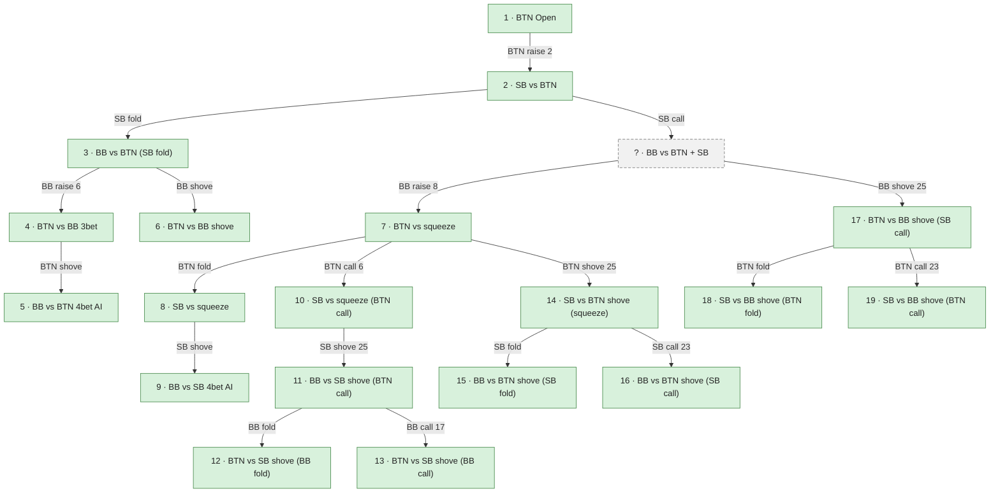

# Painel preflop — DeepGT

🟢 Codificada · ⚪ Falta print · 🔵 Recebida, falta codificar (apenas se houver trabalho realmente pendente) · — Não aplicável.

Codificada significa que a chart já está no arquivo de desenvolvimento; não significa estratégia homologada ou ativa. As ressalvas de precisão e validação ficam na [auditoria técnica](AUDIT_25BB_DRAFT.md), sob responsabilidade do desenvolvimento.

## 1. Matriz de cobertura

| Cenário | 25 | 23 | 20 | 17 | 15 | 12 | 10 | 8 | 6 | 4 | 2 |
|---|:---:|:---:|:---:|:---:|:---:|:---:|:---:|:---:|:---:|:---:|:---:|
| BTN Open | 🟢 | ⚪ | ⚪ | ⚪ | ⚪ | ⚪ | ⚪ | ⚪ | ⚪ | ⚪ | ⚪ |
| SB vs BTN | 🟢 | ⚪ | ⚪ | ⚪ | ⚪ | ⚪ | ⚪ | ⚪ | ⚪ | ⚪ | ⚪ |
| BB vs BTN (SB fold) | 🟢 | ⚪ | ⚪ | ⚪ | ⚪ | ⚪ | ⚪ | ⚪ | ⚪ | ⚪ | ⚪ |
| BTN vs BB 3bet | 🟢 | ⚪ | ⚪ | ⚪ | ⚪ | ⚪ | ⚪ | ⚪ | ⚪ | ⚪ | ⚪ |
| BB vs BTN 4bet AI | 🟢 | ⚪ | ⚪ | ⚪ | ⚪ | ⚪ | ⚪ | ⚪ | ⚪ | ⚪ | ⚪ |
| BTN vs BB shove | 🟢 | ⚪ | ⚪ | ⚪ | ⚪ | ⚪ | ⚪ | ⚪ | ⚪ | ⚪ | ⚪ |
| BTN vs squeeze | 🟢 | ⚪ | ⚪ | ⚪ | ⚪ | ⚪ | ⚪ | ⚪ | ⚪ | ⚪ | ⚪ |
| SB vs squeeze | 🟢 | ⚪ | ⚪ | ⚪ | ⚪ | ⚪ | ⚪ | ⚪ | ⚪ | ⚪ | ⚪ |
| BB vs SB 4bet AI | 🟢 | ⚪ | ⚪ | ⚪ | ⚪ | ⚪ | ⚪ | ⚪ | ⚪ | ⚪ | ⚪ |
| BB vs BTN + SB | ⚪ | ⚪ | ⚪ | ⚪ | ⚪ | ⚪ | ⚪ | ⚪ | ⚪ | ⚪ | ⚪ |
| SB vs squeeze (BTN call) | 🟢 | ⚪ | ⚪ | ⚪ | ⚪ | ⚪ | ⚪ | ⚪ | ⚪ | ⚪ | ⚪ |
| BB vs SB shove (BTN call) | 🟢 | ⚪ | ⚪ | ⚪ | ⚪ | ⚪ | ⚪ | ⚪ | ⚪ | ⚪ | ⚪ |
| BTN vs SB shove (BB fold) | 🟢 | ⚪ | ⚪ | ⚪ | ⚪ | ⚪ | ⚪ | ⚪ | ⚪ | ⚪ | ⚪ |
| BTN vs SB shove (BB call) | 🟢 | ⚪ | ⚪ | ⚪ | ⚪ | ⚪ | ⚪ | ⚪ | ⚪ | ⚪ | ⚪ |
| SB vs BTN shove (squeeze) | 🟢 | ⚪ | ⚪ | ⚪ | ⚪ | ⚪ | ⚪ | ⚪ | ⚪ | ⚪ | ⚪ |
| BB vs BTN shove (SB fold) | 🟢 | ⚪ | ⚪ | ⚪ | ⚪ | ⚪ | ⚪ | ⚪ | ⚪ | ⚪ | ⚪ |
| BB vs BTN shove (SB call) | 🟢 | ⚪ | ⚪ | ⚪ | ⚪ | ⚪ | ⚪ | ⚪ | ⚪ | ⚪ | ⚪ |
| BTN vs BB shove (SB call) | 🟢 | ⚪ | ⚪ | ⚪ | ⚪ | ⚪ | ⚪ | ⚪ | ⚪ | ⚪ | ⚪ |
| SB vs BB shove (BTN fold) | 🟢 | ⚪ | ⚪ | ⚪ | ⚪ | ⚪ | ⚪ | ⚪ | ⚪ | ⚪ | ⚪ |
| SB vs BB shove (BTN call) | 🟢 | ⚪ | ⚪ | ⚪ | ⚪ | ⚪ | ⚪ | ⚪ | ⚪ | ⚪ | ⚪ |

| Stack | Codificadas | Falta print | Recebidas a codificar |
|---:|---:|---:|---:|
| 25 | 19 | 1 | 0 |
| 23 | 0 | 20 | 0 |
| 20 | 0 | 20 | 0 |
| 17 | 0 | 20 | 0 |
| 15 | 0 | 20 | 0 |
| 12 | 0 | 20 | 0 |
| 10 | 0 | 20 | 0 |
| 8 | 0 | 20 | 0 |
| 6 | 0 | 20 | 0 |
| 4 | 0 | 20 | 0 |
| 2 | 0 | 20 | 0 |

Somente famílias identificadas; a matriz cresce conforme novos cenários são mapeados. Os espaços vazios nos demais stacks não confirmam que os históricos sejam aplicáveis.

## 2. Sequências e árvores por stack

### 25 BB

| Print | Sequência anterior | Hero | Estado |
|---:|---|---|---|
| 1 | Pote não aberto | BTN | 🟢 Codificada |
| 2 | BTN raise 2 | SB | 🟢 Codificada |
| 3 | BTN raise 2 → SB fold | BB | 🟢 Codificada |
| 4 | BTN raise 2 → SB fold → BB raise 6 | BTN | 🟢 Codificada |
| 5 | BTN raise 2 → SB fold → BB raise 6 → BTN shove | BB | 🟢 Codificada |
| 6 | BTN raise 2 → SB fold → BB shove | BTN | 🟢 Codificada |
| 7 | BTN raise 2 → SB call → BB raise 8 | BTN | 🟢 Codificada |
| 8 | BTN raise 2 → SB call → BB raise 8 → BTN fold | SB | 🟢 Codificada |
| 9 | BTN raise 2 → SB call → BB raise 8 → BTN fold → SB shove | BB | 🟢 Codificada |
| — | BTN raise 2 → SB call | BB | ⚪ Falta print |
| 10 | BTN raise 2 → SB call → BB raise 8 → BTN call 6 | SB | 🟢 Codificada |
| 11 | BTN raise 2 → SB call → BB raise 8 → BTN call 6 → SB shove 25 | BB | 🟢 Codificada |
| 12 | BTN raise 2 → SB call → BB raise 8 → BTN call 6 → SB shove 25 → BB fold | BTN | 🟢 Codificada |
| 13 | BTN raise 2 → SB call → BB raise 8 → BTN call 6 → SB shove 25 → BB call 17 | BTN | 🟢 Codificada |
| 14 | BTN raise 2 → SB call → BB raise 8 → BTN shove 25 | SB | 🟢 Codificada |
| 15 | BTN raise 2 → SB call → BB raise 8 → BTN shove 25 → SB fold | BB | 🟢 Codificada |
| 16 | BTN raise 2 → SB call → BB raise 8 → BTN shove 25 → SB call 23 | BB | 🟢 Codificada |
| 17 | BTN raise 2 → SB call → BB shove 25 | BTN | 🟢 Codificada |
| 18 | BTN raise 2 → SB call → BB shove 25 → BTN fold | SB | 🟢 Codificada |
| 19 | BTN raise 2 → SB call → BB shove 25 → BTN call 23 | SB | 🟢 Codificada |

## 3. Referências

- [Registro fonte](../charts/PREFLOP_REGISTRY.json) — histórico, fontes, detalhes técnicos.
- [Catálogo](CHARTS_CATALOG.md) — frequências e arquivos.
- [Status](STATUS.md) — situação e pendências reais.
- [Política de ingestão](PREFLOP_POLICY.md) — fluxo obrigatório.
